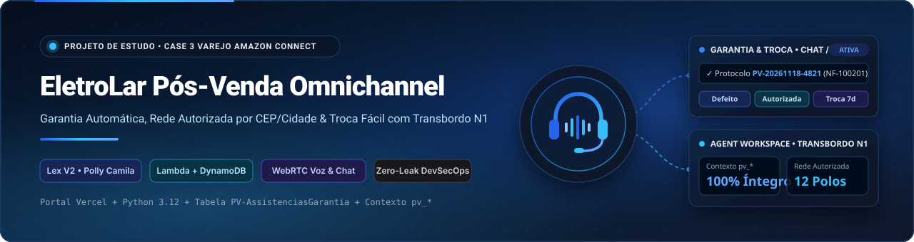
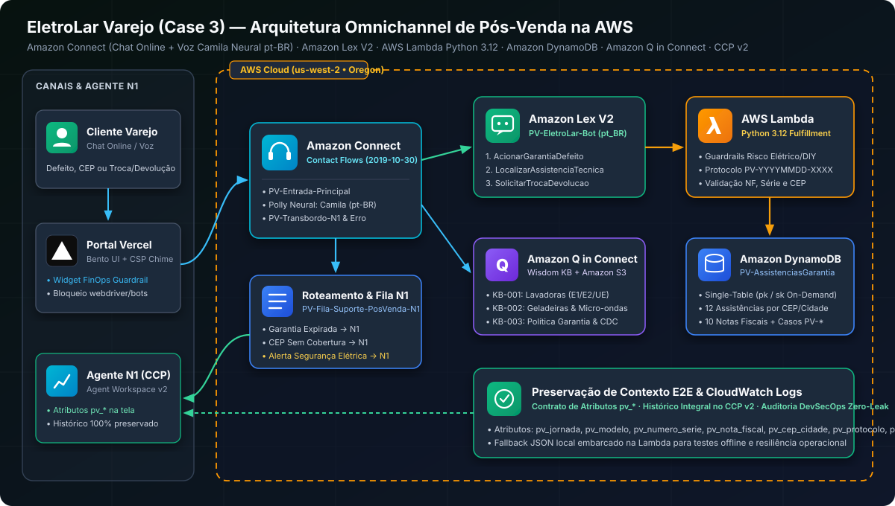
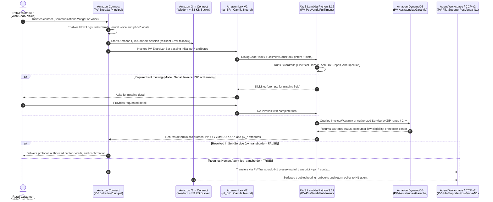
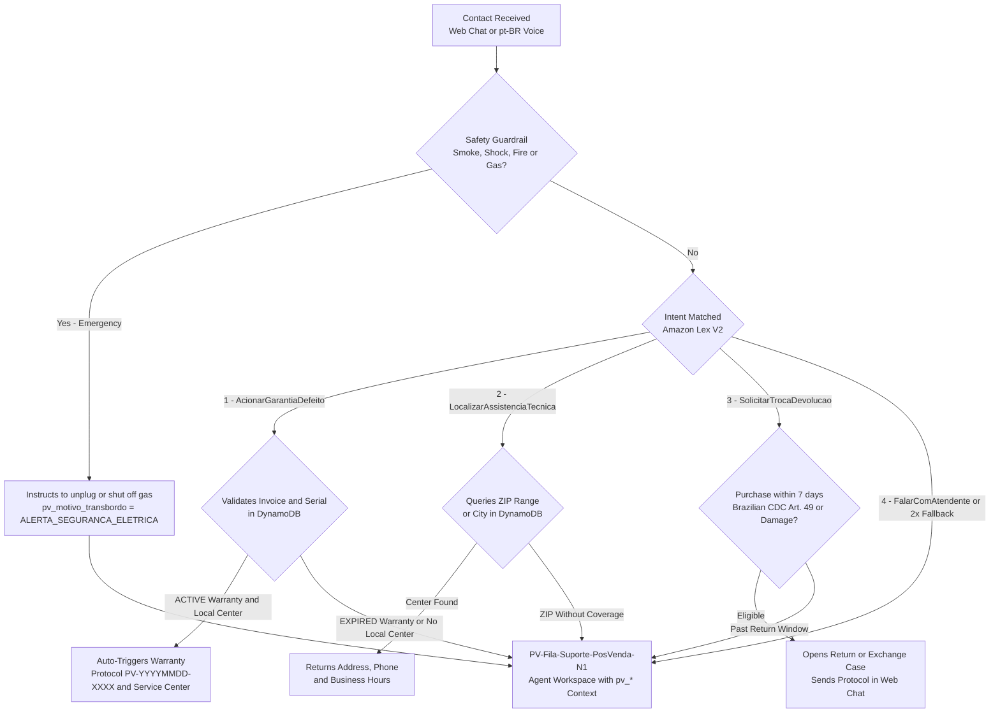
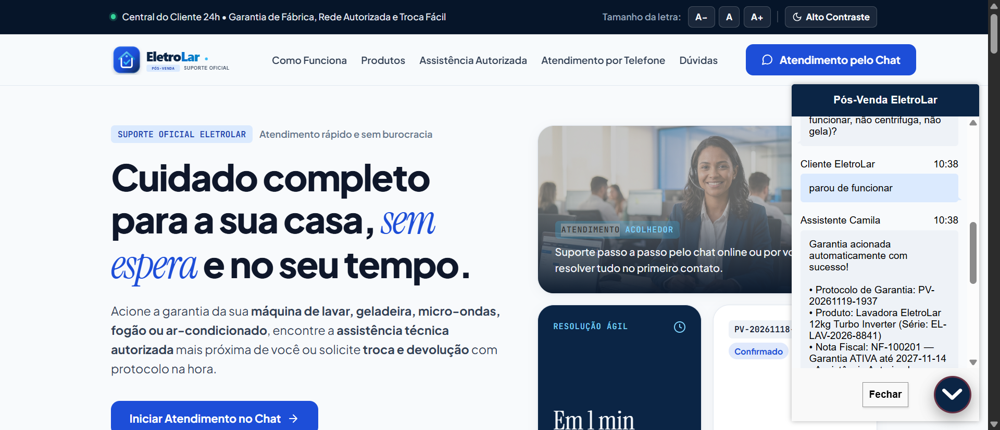
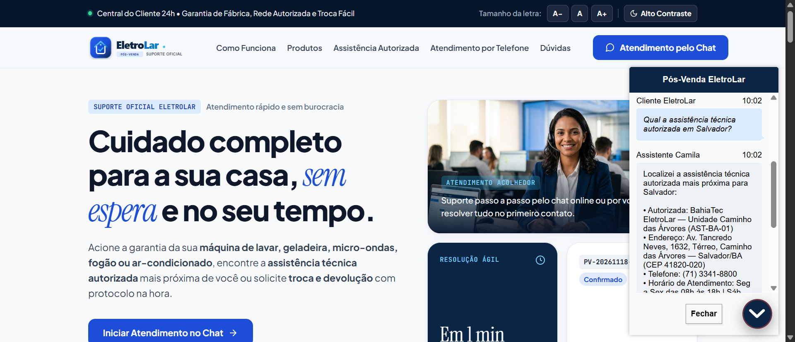
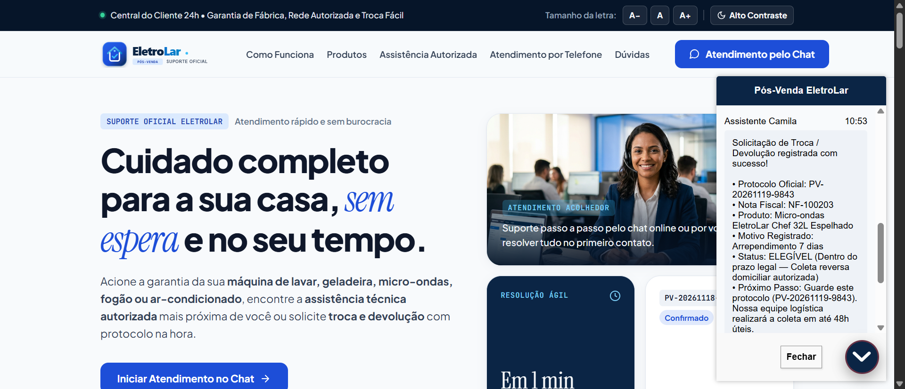
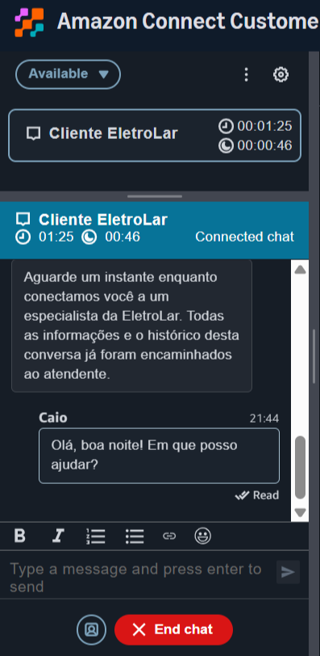
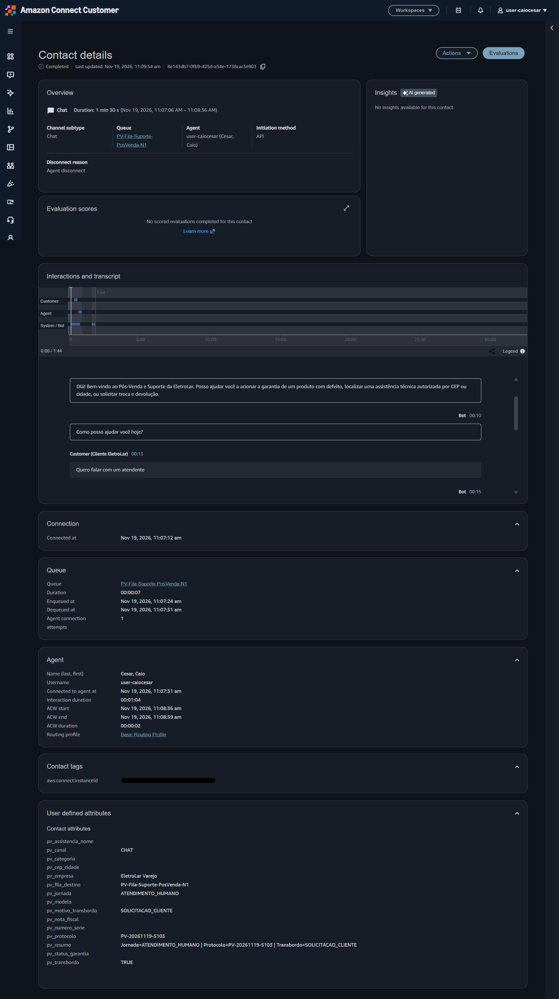
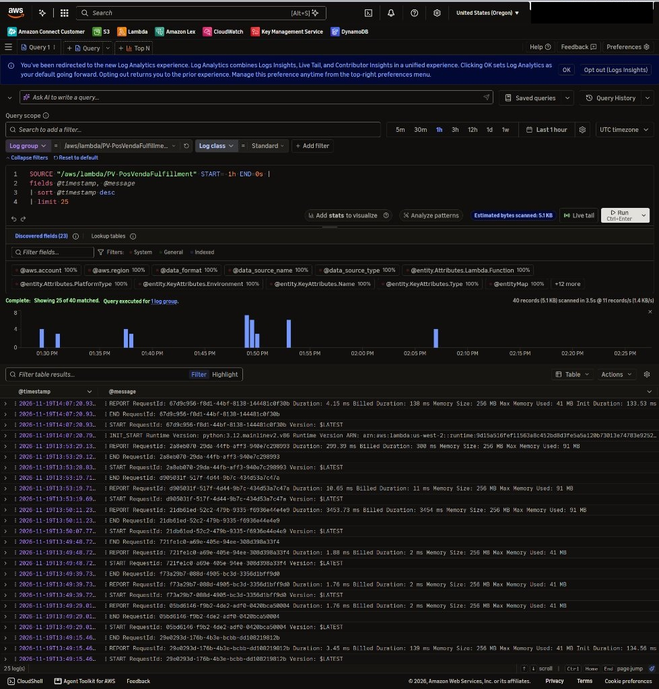

<p align="center">
  <a href="README.md">🇧🇷 Português</a> &nbsp;|&nbsp; <strong>🇺🇸 English</strong>
</p>

<p align="center">
  
</p>

<h1 align="center">EletroLar Post-Sales — Omnichannel Amazon Connect Study (Case 3)</h1>

<p align="center">
  <a href="https://amazon-connect-pos-vendas-case3.vercel.app/"></a>
  <a href="https://github.com/caiocesarti/amazon-connect-pos-vendas-case3/actions/workflows/ci.yml"></a>
  
  
  
  
  
  
</p>

<p align="center">
  <strong>🌐 Live Web Portal (Vercel + Official Amazon Connect Widget):</strong>
  <a href="https://amazon-connect-pos-vendas-case3.vercel.app/">https://amazon-connect-pos-vendas-case3.vercel.app/</a>
</p>

> **⚠️ Notice — Study & Portfolio Project (Not Production-Ready):**  
> This repository is intended **strictly for educational and technical portfolio purposes**, built as a hands-on AWS Cloud Architecture study for **Case 3 — Retail: Home Appliance Post-Sales & Technical Support (Escola da Nuvem + AWS)**. It integrates **Amazon Connect**, **Amazon Lex V2 (`pt_BR` with neural voice `Camila`)**, **AWS Lambda (Python 3.12)**, **Amazon DynamoDB** (`PV-AssistenciasGarantia`), and **Amazon Q in Connect**. **It is NOT ready for production:** it uses a 100% fictional retailer and simulated dataset (*EletroLar Varejo S.A.* in `data/pos_venda_varejo.json`), with no live ERP/tax integration, customer authentication, or high-throughput production hardening.

Functional prototype of an **Omnichannel Home Appliance Post-Sales & Support Center (Web Chat & pt-BR WebRTC Voice)** paired with an accessible **Bento Box UI** web portal ([`landing/`](landing/)) deployed at **[https://amazon-connect-pos-vendas-case3.vercel.app/](https://amazon-connect-pos-vendas-case3.vercel.app/)** featuring the official **Amazon Connect Communications Widget** and an anti-bot FinOps guard layer.

> **💡 FinOps & Dual Demo Mode Note:**  
> During AWS validation, the Vercel portal runs connected to the **official Amazon Connect Communications Widget** (`Lex V2` + `Lambda` + `DynamoDB`). Following the planned AWS lab teardown to maintain **zero ongoing cloud cost**, the portal gracefully degrades into an **Interactive Local Simulator**, enabling visitors and reviewers to explore all 4 user journeys directly in the browser at zero cloud cost, while all real AWS execution proofs remain documented under [`docs/evidencias/`](docs/evidencias/) and [`docs/03-testes-e-evidencias.md`](docs/03-testes-e-evidencias.md).

---

## 1. AWS Solution Architecture



---

## 2. Conversational Flow & Omnichannel Sequence (Mermaid)



### Decision Tree — 3 Core Journeys + Guardrails & Human Handoff



---

## 3. Deliverables Matrix (1:1 Mapping to Case Study Requirements)

| # | Case Study Requirement (Case 3) | Technical Implementation | Real AWS Evidence |
|---|---|---|---|
| **1** | **Scenario 1 — Product Defect:** Customer reports broken washing machine; bot collects **model**, **serial number**, and **invoice number**, and automatically triggers warranty service. | `AcionarGarantiaDefeito` intent in [`lex/bot-export.json`](lex/bot-export.json), invoice/serial normalization & service order creation in [`lambda/pos_venda_fulfillment/garantia_troca.py`](lambda/pos_venda_fulfillment/garantia_troca.py), routed by [`handler.py`](lambda/pos_venda_fulfillment/handler.py). | [`01a`](docs/evidencias/01a-cenario1-defeito-pergunta-bot.png), [`01b`](docs/evidencias/01b-cenario1-garantia-acionada-protocolo.png), [`01c`](docs/evidencias/01c-cenario1-autorizada-vinculada.png) *(Protocol `PV-20261119-1937`)* |
| **2** | **Scenario 2 — Authorized Service Locator:** Queries **DynamoDB** by **ZIP code (CEP) or city** and returns the nearest authorized center with **address, phone, and business hours**. | `LocalizarAssistenciaTecnica` intent in [`lex/bot-export.json`](lex/bot-export.json), ZIP-range & normalized city lookup in [`lambda/pos_venda_fulfillment/assistencia.py`](lambda/pos_venda_fulfillment/assistencia.py), seeded via [`scripts/seed_dynamodb.py`](scripts/seed_dynamodb.py). | [`02`](docs/evidencias/02-cenario2-assistencia-cep-cidade.png) *(BahiaTec EletroLar — Salvador/BA)* |
| **3** | **Scenario 3 — Exchange / Return:** Collects required details, **creates a case**, validates return eligibility, and **sends the tracking protocol via web chat**. | `SolicitarTrocaDevolucao` intent in [`lex/bot-export.json`](lex/bot-export.json), 7-day statutory return check + DynamoDB case persistence and deterministic protocol `PV-YYYYMMDD-XXXX` in [`garantia_troca.py`](lambda/pos_venda_fulfillment/garantia_troca.py). | [`03`](docs/evidencias/03-cenario3-troca-devolucao-protocolo.png), [`03b`](docs/evidencias/03b-cenario3-troca-protocolo.png), [`03c`](docs/evidencias/03c-cenario3-contact-details-atributos.png) *(Protocol `PV-20261119-9843`)* |
| **4** | **Scenario 4 — Context-Preserving Human Handoff:** Transfers unresolved contacts to a human agent with **full chat transcript and structured context in Agent Workspace**. | Contact Flows [`PV-Entrada-Principal.json`](connect-flows/PV-Entrada-Principal.json) and [`PV-Transbordo-N1.json`](connect-flows/PV-Transbordo-N1.json) propagating the `pv_*` attribute contract to queue `PV-Fila-Suporte-PosVenda-N1`. | [`04a`](docs/evidencias/04a-cenario4-transbordo-chat-cliente.png), [`04b`](docs/evidencias/04b-cenario4-transbordo-chat-conectado.png), [`04c`](docs/evidencias/04c-cenario4-agent-workspace-ccp.png), [`04d`](docs/evidencias/04d-cenario4-contact-details-atributos-transbordo.png) |
| **5** | **End-to-End Verification & Interaction Logs:** Functional flows + AWS Lambda integration + E2E screenshots and execution logs. | Automated test suite [`tests/`](tests/) (36 tests, 93% coverage), Vercel portal [`landing/`](landing/), and E2E handbook + CloudWatch logs in [`docs/03-testes-e-evidencias.md`](docs/03-testes-e-evidencias.md). | [`06`](docs/evidencias/06-cloudwatch-logs-lambda.png) *(CloudWatch Log Analytics + Transcripts)* |
| **+** | **Additional Senior Portfolio Pillars (Amazon Q, Guardrails, FinOps & Zero-Leak)** | [`knowledge-base/`](knowledge-base/) runbooks for Amazon Q in Connect, electrical-hazard/anti-DIY/anti-injection guardrails in [`guardrails.py`](lambda/pos_venda_fulfillment/guardrails.py), FinOps widget injectors [`injetar_widget.js`](scripts/injetar_widget.js)/[`.py`](scripts/injetar_widget.py), and Zero-Leak scanner [`verificar_segredos.py`](scripts/verificar_segredos.py). | [`05`](docs/evidencias/05-amazon-q-knowledge-base.png) *(`PV-Q-Assistant` + S3 KB)* |

---

## 4. Repository Structure

```text
amazon-connect-pos-venda-case3/
├── .github/workflows/ci.yml                 # CI Pipeline: Zero-Leak, Dataset, Flows & Pytest w/ Coverage
├── .env.example                             # Parameterized environment variables with safe placeholders
├── .gitignore                               # Blocks .env, widget-snippet.local.html, internal PDFs & zips
├── README.md / README.en.md                 # Bilingual documentation (PT-BR & EN)
├── SECURITY.md                              # DevSecOps Zero-Leak policy
├── package.json                             # Node.js build hook for Vercel widget injection
├── vercel.json                              # Security headers & CSP for Amazon Connect + Chime WebRTC
├── data/
│   └── pos_venda_varejo.json                # Fictional dataset (12 Service Centers + 10 Invoices/Warranties)
├── knowledge-base/                          # Technical runbooks & policies for Amazon Q in Connect
│   ├── 01-troubleshooting-lavadoras.md
│   ├── 02-troubleshooting-refrigeracao-microondas.md
│   └── 03-politica-garantia-troca-devolucao.md
├── lambda/
│   └── pos_venda_fulfillment/               # Serverless Python 3.12 Backend
│       ├── handler.py                       # Lex V2 DialogCodeHook & FulfillmentCodeHook router
│       ├── assistencia.py                   # DynamoDB lookup (with JSON fallback) by ZIP range or city
│       ├── garantia_troca.py                # Warranty activation, return workflow & PV-YYYYMMDD-XXXX IDs
│       ├── guardrails.py                    # Electrical hazard, anti-DIY repair & prompt-injection guards
│       └── respostas.py                     # Channel-aware response templates (Chat & Polly Camila Voice)
├── lex/
│   ├── bot-export.json                      # Sanitized PV-EletroLar-Bot definition (pt_BR, Camila Neural)
│   ├── slot-types.json                      # Custom slot types
│   └── README-lex.md                        # Lex V2 intents, slots & alias guide
├── connect-flows/                           # Amazon Connect Flows (schema 2019-10-30, sanitized)
│   ├── PV-Entrada-Principal.json            # Logs -> Camila Voice -> pt-BR -> Q in Connect -> pv_* -> Lex V2
│   ├── PV-Transbordo-N1.json                # pv_* Context -> Operating Hours -> N1 Human Queue (CCP v2)
│   └── PV-Erro-Generico.json                # Graceful fallback message & safe disconnect
├── landing/                                 # Accessible Bento Box UI Web Portal (EletroLar Varejo)
│   ├── assets/                              # SVG logos, illustrations & generated editorial imagery
│   ├── index.html                           # Responsive portal with service locator & chat drawer
│   ├── styles.css                           # Editorial design system + High Contrast & font scaling (A-/A+)
│   ├── app.js                               # Interactive directory, Connect Widget integration & local simulator
│   └── widget-snippet.example.html          # Sanitized Communications Widget snippet template
├── scripts/
│   ├── verificar_segredos.py                # DevSecOps Zero-Leak audit (blocks real AWS Account IDs & keys)
│   ├── validar_dataset.py                   # Dataset schema, ZIP ranges & edge-case validator
│   ├── validar_flows.py                     # Structural Contact Flow validator (2019-10-30)
│   ├── provisionar_lex_v2.py                # Automated Lex V2 IaC provisioning (intents, slots, version, alias)
│   ├── seed_dynamodb.py                     # Batch loader for DynamoDB table PV-AssistenciasGarantia
│   ├── injetar_widget.js                    # Node.js FinOps widget injector used during Vercel builds
│   ├── injetar_widget.py                    # Python FinOps widget injector for local lab runs
│   ├── empacotar_lambda.py                  # Builds dist/pos_venda_fulfillment.zip deployment artifact
│   └── servir_local.py                      # Local dev server (Web Portal + /api/lex Lambda simulator)
├── tests/                                   # Pytest suite (36 tests, 93% coverage across all modules)
│   ├── test_assistencia.py
│   ├── test_garantia_troca.py
│   ├── test_guardrails.py
│   ├── test_handler_e2e.py
│   └── test_scripts_validacao.py
└── docs/
    ├── assets/                              # Header SVG banner & AWS architecture SVG diagram
    ├── evidencias/                          # 13 sanitized real AWS screenshots (Scenarios 1–4, Q, CloudWatch)
    ├── 01-arquitetura.md                    # Single-Table DynamoDB design, pv_* contract & guardrails
    ├── 02-passo-a-passo.md                  # Bottom-up AWS Console & Vercel deployment runbook
    └── 03-testes-e-evidencias.md            # E2E test matrix (CT-01 to CT-08), transcripts & CloudWatch logs
```

---

## 5. Running & Testing Locally (No AWS Account Required)

### Prerequisites
- Python 3.12+

### Step-by-Step

```bash
# 1. Clone the repository, create a virtual environment, and install dependencies
git clone https://github.com/caiocesarti/amazon-connect-pos-vendas-case3.git
cd amazon-connect-pos-vendas-case3
python -m venv .venv
# Windows: .venv\Scripts\activate | Linux/macOS: source .venv/bin/activate
pip install -r requirements-dev.txt

# 2. Run Zero-Leak audit, dataset/flow validators, DynamoDB dry-run, and Pytest with coverage
python scripts/verificar_segredos.py
python scripts/validar_dataset.py
python scripts/validar_flows.py
python scripts/seed_dynamodb.py --dry-run
python -m pytest --cov=lambda/pos_venda_fulfillment --cov-report=term-missing

# 3. Start the Local Web Portal + Simulated Lambda Backend (zero AWS cost)
python scripts/servir_local.py --porta 8080
```

Open **[http://localhost:8080](http://localhost:8080)**, click **Iniciar Atendimento no Chat** (or the floating **Chat Online** button), and test all 4 scenarios:
1. **Scenario 1 (Defect / Warranty):** Click **`Defeito na lavadora`** (or send `"Minha lavadora série EL-LAV-2026-8841 nota NF-100201 parou de funcionar"`) to trigger automatic warranty activation with protocol and linked authorized center (`TecnoLar Paulista`).
2. **Scenario 2 (Service Center Locator):** Use the page directory or click **`Autorizada CEP 01310-200`** in chat (or type `Salvador`) to retrieve address, phone number, and business hours.
3. **Scenario 3 (Exchange / Return):** Click **`Solicitar troca`** (`NF-100203`) to open an eligible 7-day return case and receive the protocol immediately in chat.
4. **Scenario 4 (Human Handoff, Edge Cases & Guardrails):** Click **`Falar com Atendente`**, or type **`CEP 69900-000`** (no local center) or **`fumaça`** (electrical hazard guardrail) to see priority protocol generation and handoff to queue `PV-Fila-Suporte-PosVenda-N1`. *(You can also send Lex V2 JSON payloads directly to `POST http://localhost:8080/api/lex`.)*

---

## 6. Validated AWS Lab Evidence (E2E + CloudWatch)

> Full test scenarios, real chat transcripts, and contact attribute audits are documented in **[docs/03-testes-e-evidencias.md](docs/03-testes-e-evidencias.md)** *(PT-BR)*:

| Scenario 1 — Defect & Auto-Warranty (`NF-100201`) | Scenario 2 — Authorized Center Lookup (`Salvador/BA`) |
| :---: | :---: |
|  |  |

| Scenario 3 — 7-Day Return (`NF-100203`) | Scenario 4 — Agent Workspace Handoff (`CCP v2`) |
| :---: | :---: |
|  |  |

| Scenario 4 — Preserved Context (`User Defined Attributes`) | CloudWatch Log Analytics — Serverless Execution |
| :---: | :---: |
|  |  |

---

## 7. Additional Documentation *(PT-BR)*

- **[docs/01-arquitetura.md](docs/01-arquitetura.md)** — Conceptual diagram, Single-Table DynamoDB schema (`PV-AssistenciasGarantia`), `pv_*` attribute contract, and safety guardrails.
- **[docs/02-passo-a-passo.md](docs/02-passo-a-passo.md)** — Bottom-up AWS Console & Vercel deployment guide (`Connect/WebRTC` $\rightarrow$ `DynamoDB` $\rightarrow$ `S3/Q` $\rightarrow$ `IAM/Lambda` $\rightarrow$ `Lex V2` $\rightarrow$ `Queues/CCP` $\rightarrow$ `Flows` $\rightarrow$ `Vercel`).
- **[docs/03-testes-e-evidencias.md](docs/03-testes-e-evidencias.md)** — End-to-end test matrix (`CT-01` to `CT-08`), real chat transcripts, and CloudWatch Logs Insights queries.
- **[SECURITY.md](SECURITY.md)** — DevSecOps governance and Zero-Leak policy.

---

## 8. License

Distributed under the [MIT](LICENSE) license.
