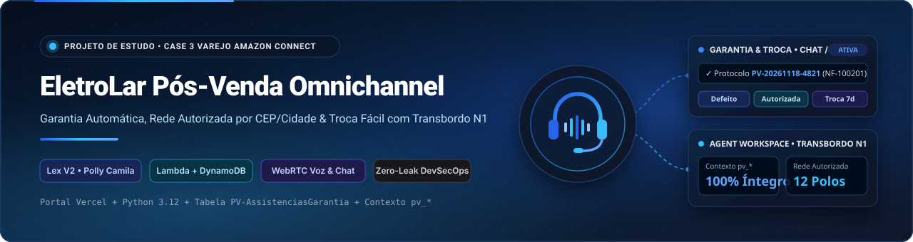
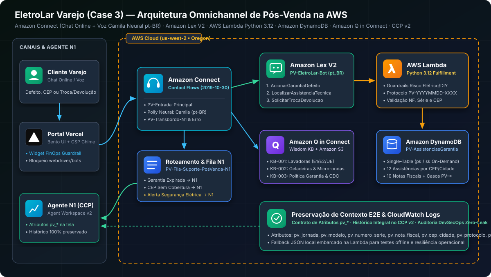
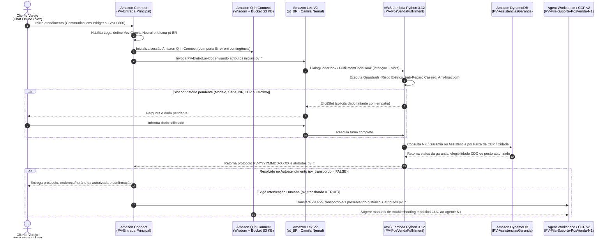
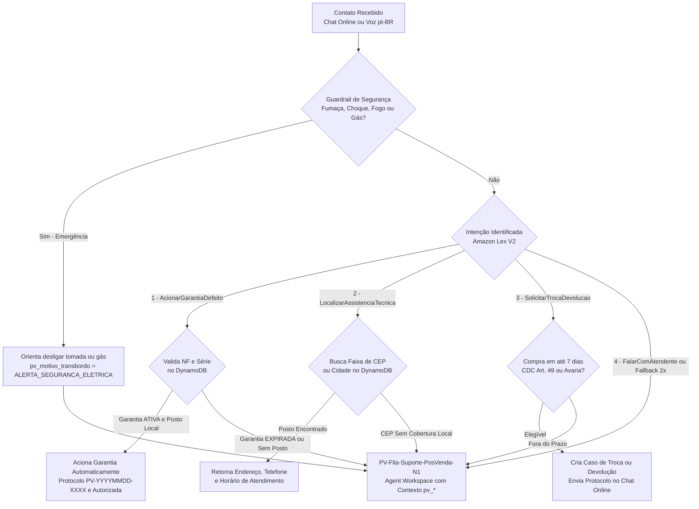
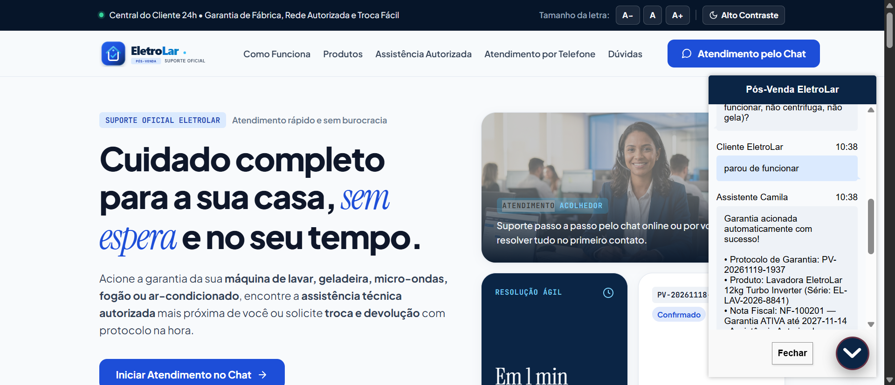
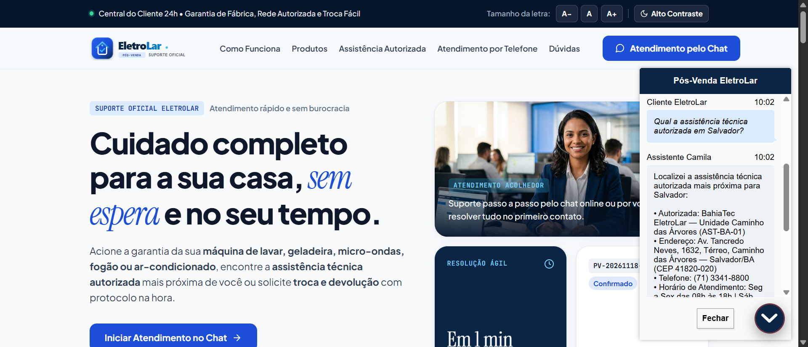
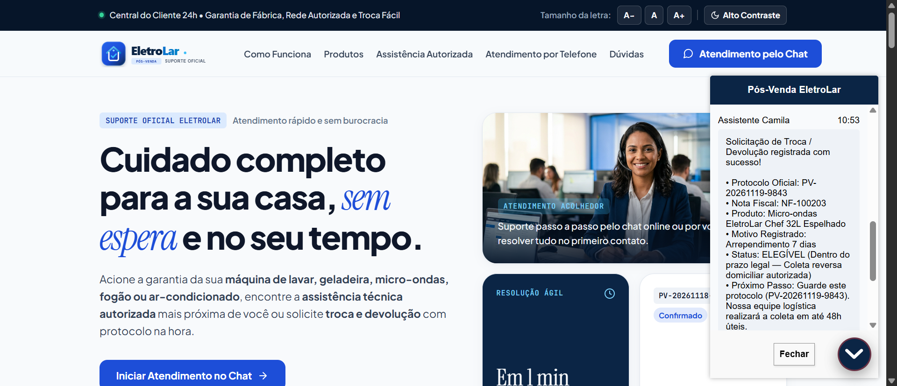
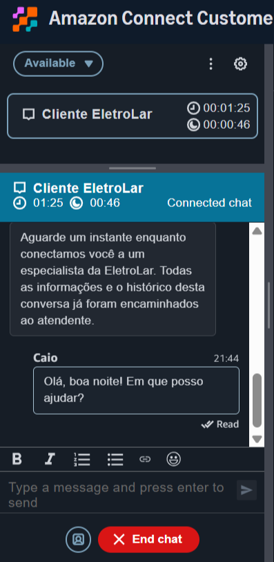
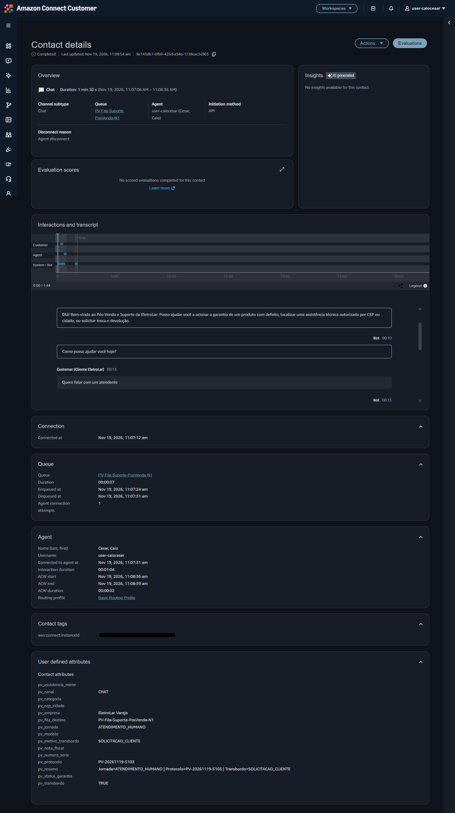
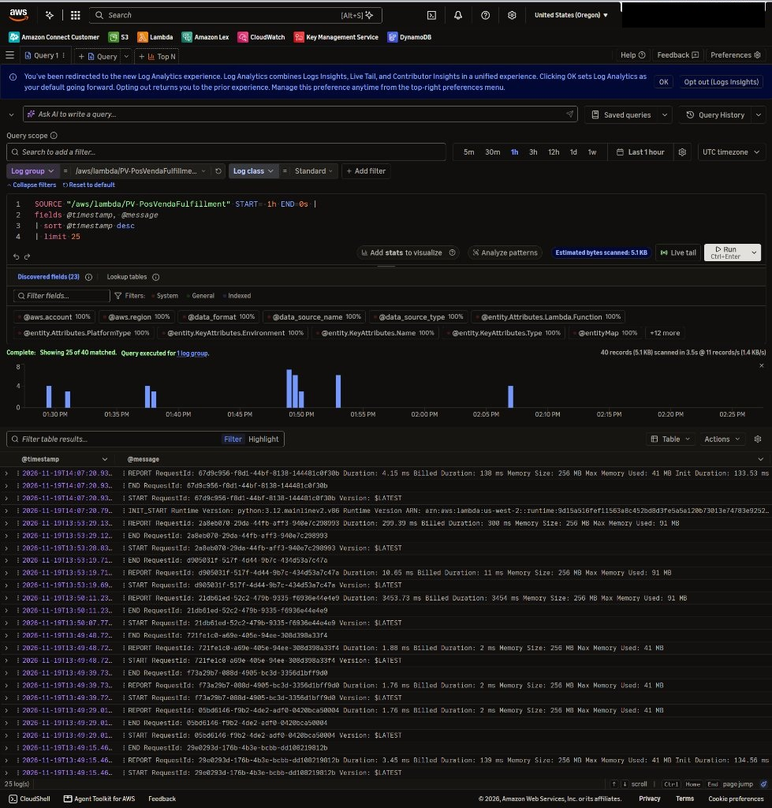

<p align="center">
  <strong>🇧🇷 Português</strong> &nbsp;|&nbsp; <a href="README.en.md">🇺🇸 English</a>
</p>

<p align="center">
  
</p>

<h1 align="center">EletroLar Pós-Venda — Estudo Amazon Connect Omnichannel (Case 3)</h1>

<p align="center">
  <a href="https://amazon-connect-pos-vendas-case3.vercel.app/"></a>
  <a href="https://github.com/caiocesarti/amazon-connect-pos-vendas-case3/actions/workflows/ci.yml"></a>
  
  
  
  
  
  
</p>

<p align="center">
  <strong>🌐 Portal Web Live (Vercel + Widget Oficial Amazon Connect):</strong>
  <a href="https://amazon-connect-pos-vendas-case3.vercel.app/">https://amazon-connect-pos-vendas-case3.vercel.app/</a>
</p>

> **⚠️ Aviso — Projeto de Estudo (Não pronto para produção):**  
> Este repositório tem finalidade **exclusivamente educacional e de portfólio técnico**, desenvolvido para o estudo prático de arquitetura em nuvem no **Case 3 — Varejo: Pós-venda e Suporte de Eletrodomésticos (Escola da Nuvem + AWS)**. Integra **Amazon Connect**, **Amazon Lex V2 (`pt_BR` com voz neural `Camila`)**, **AWS Lambda (Python 3.12)**, **Amazon DynamoDB** (`PV-AssistenciasGarantia`) e **Amazon Q in Connect**. **Ele NÃO está pronto para uso em produção:** utiliza uma empresa varejista e massa de dados 100% fictícia (*EletroLar Varejo S.A.* em `data/pos_venda_varejo.json`), sem integração com ERP fiscal real (SEFAZ), sem autenticação de clientes ou hardening produtivo de alta volumetria.

Protótipo funcional de uma **Central de Pós-Venda e Suporte Técnico de Eletrodomésticos Omnichannel (Chat Online & Voz WebRTC pt-BR)** acompanhado do Portal Web acessível em **Bento Box UI** ([`landing/`](landing/)) publicado em **[https://amazon-connect-pos-vendas-case3.vercel.app/](https://amazon-connect-pos-vendas-case3.vercel.app/)** com o **Communications Widget** oficial e camada FinOps anti-bot.

> **💡 Nota de FinOps & Modo Dual de Demonstração:**  
> Durante a etapa de homologação na AWS, o portal da Vercel opera conectado ao **Communications Widget oficial do Amazon Connect** (`Lex V2` + `Lambda` + `DynamoDB`). Após o encerramento e *teardown* planejado do laboratório na conta AWS para manter **custo zero**, o portal degrada graciosamente para o **Simulador Interativo Local**, permitindo que qualquer visitante teste os 4 cenários no navegador sem gerar custos de nuvem, enquanto todas as comprovações da execução real na AWS permanecem registradas em [`docs/evidencias/`](docs/evidencias/) e [`docs/03-testes-e-evidencias.md`](docs/03-testes-e-evidencias.md).

---

## 1. Arquitetura AWS da Solução



---

## 2. Fluxo Conversacional & Sequência Omnichannel (Mermaid)



### Árvore de Decisão das 3 Jornadas + Guardrails e Transbordo



---

## 3. Entregáveis Implementados (Matriz 1:1 com o Estudo de Caso — Case 3)

| # | Requisito / Entregável do Estudo de Caso (Case 3) | Implementação Técnica no Repositório | Evidência Real (AWS) |
|---|---|---|---|
| **1** | **Cenário 1 — Defeito no produto:** Cliente reporta que a máquina de lavar parou de funcionar; bot coleta **modelo**, **número de série** e **nota fiscal** e aciona o fluxo de garantia automaticamente. | Intenção `AcionarGarantiaDefeito` em [`lex/bot-export.json`](lex/bot-export.json), validação de NF/Série e geração de OS em [`lambda/pos_venda_fulfillment/garantia_troca.py`](lambda/pos_venda_fulfillment/garantia_troca.py) e roteamento em [`lambda/pos_venda_fulfillment/handler.py`](lambda/pos_venda_fulfillment/handler.py). | [`01a`](docs/evidencias/01a-cenario1-defeito-pergunta-bot.png), [`01b`](docs/evidencias/01b-cenario1-garantia-acionada-protocolo.png), [`01c`](docs/evidencias/01c-cenario1-autorizada-vinculada.png) *(Protocolo `PV-20261119-1937`)* |
| **2** | **Cenário 2 — Localização de assistência técnica:** Com base no **CEP ou cidade** informada, consulta o **DynamoDB** e retorna a autorizada mais próxima com **endereço, telefone e horário de atendimento**. | Intenção `LocalizarAssistenciaTecnica` em [`lex/bot-export.json`](lex/bot-export.json), busca por faixa de CEP e cidade normalizada em [`lambda/pos_venda_fulfillment/assistencia.py`](lambda/pos_venda_fulfillment/assistencia.py) e seed da tabela `PV-AssistenciasGarantia` via [`scripts/seed_dynamodb.py`](scripts/seed_dynamodb.py). | [`02`](docs/evidencias/02-cenario2-assistencia-cep-cidade.png) *(BahiaTec EletroLar — Salvador/BA)* |
| **3** | **Cenário 3 — Troca / devolução:** Fluxo para iniciar o processo de troca ou devolução com coleta de informações, **criação de caso** e **envio de protocolo por chat online**. | Intenção `SolicitarTrocaDevolucao` em [`lex/bot-export.json`](lex/bot-export.json), validação CDC (7 dias) + persistência de caso e protocolo `PV-YYYYMMDD-XXXX` em [`lambda/pos_venda_fulfillment/garantia_troca.py`](lambda/pos_venda_fulfillment/garantia_troca.py). | [`03`](docs/evidencias/03-cenario3-troca-devolucao-protocolo.png), [`03b`](docs/evidencias/03b-cenario3-troca-protocolo.png), [`03c`](docs/evidencias/03c-cenario3-contact-details-atributos.png) *(Protocolo `PV-20261119-9843`)* |
| **4** | **Cenário 4 & Entregável 3 — Transbordo com contexto preservado:** Agente recebe histórico completo da conversa e contexto no **Agent Workspace**. | Contact Flows [`connect-flows/PV-Entrada-Principal.json`](connect-flows/PV-Entrada-Principal.json) e [`connect-flows/PV-Transbordo-N1.json`](connect-flows/PV-Transbordo-N1.json) propagando o contrato `pv_*` (`pv_resumo`, `pv_jornada`, `pv_protocolo`, `pv_motivo_transbordo`) para a fila `PV-Fila-Suporte-PosVenda-N1`. | [`04a`](docs/evidencias/04a-cenario4-transbordo-chat-cliente.png), [`04b`](docs/evidencias/04b-cenario4-transbordo-chat-conectado.png), [`04c`](docs/evidencias/04c-cenario4-agent-workspace-ccp.png), [`04d`](docs/evidencias/04d-cenario4-contact-details-atributos-transbordo.png) |
| **5** | **Entregáveis 1, 2 e 4 do PDF:** Fluxo funcional + Integração AWS Lambda + **Teste E2E com prints de tela e log de interações**. | Suíte [`tests/`](tests/) (36 testes), portal [`landing/`](landing/) na Vercel e caderno E2E + CloudWatch em [`docs/03-testes-e-evidencias.md`](docs/03-testes-e-evidencias.md). | [`06`](docs/evidencias/06-cloudwatch-logs-lambda.png) *(CloudWatch Log Analytics + Transcrições)* |
| **+** | **Pilares Adicionais de Portfólio (Amazon Q, Guardrails, FinOps & Zero-Leak)** | KB [`knowledge-base/`](knowledge-base/) para o Amazon Q in Connect, guardrails elétricos/anti-reparo caseiro em [`guardrails.py`](lambda/pos_venda_fulfillment/guardrails.py), injetores [`injetar_widget.js`](scripts/injetar_widget.js)/[`.py`](scripts/injetar_widget.py) e scanner [`verificar_segredos.py`](scripts/verificar_segredos.py). | [`05`](docs/evidencias/05-amazon-q-knowledge-base.png) *(Domínio `PV-Q-Assistant` + S3 KB)* |

---

## 4. Estrutura do Repositório

```text
amazon-connect-pos-venda-case3/
├── .github/workflows/ci.yml                 # Pipeline CI: Zero-Leak, Dataset, Flows e Pytest com Cobertura
├── .env.example                             # Variáveis parametrizadas com placeholders seguros
├── .gitignore                               # Bloqueio de .env, widget-snippet.local.html, PDFs internos e zips
├── README.md / README.en.md                 # Documentação bilíngue (Português e Inglês)
├── SECURITY.md                              # Política DevSecOps Zero-Leak
├── package.json                             # Build hook Node.js para injeção segura do widget na Vercel
├── vercel.json                              # Headers de segurança e CSP para Amazon Connect + Chime WebRTC
├── data/
│   └── pos_venda_varejo.json                # Dataset fictício (12 Assistências por CEP/Cidade + 10 NFs/Garantias)
├── knowledge-base/                          # Artigos técnicos e políticas para o Amazon Q in Connect (Wisdom)
│   ├── 01-troubleshooting-lavadoras.md
│   ├── 02-troubleshooting-refrigeracao-microondas.md
│   └── 03-politica-garantia-troca-devolucao.md
├── lambda/
│   └── pos_venda_fulfillment/               # Backend Serverless em Python 3.12
│       ├── handler.py                       # Roteador DialogCodeHook e FulfillmentCodeHook (Lex V2)
│       ├── assistencia.py                   # Busca no DynamoDB (com fallback JSON) por CEP ou Cidade
│       ├── garantia_troca.py                # Garantia automática, abertura de troca e protocolo PV-YYYYMMDD-XXXX
│       ├── guardrails.py                    # Detecção de risco elétrico/fumaça, anti-reparo caseiro e anti-injection
│       └── respostas.py                     # Mensagens empáticas adaptadas para Chat Online e Voz (Polly Camila)
├── lex/
│   ├── bot-export.json                      # Definição sanitizada do bot PV-EletroLar-Bot (pt_BR, Camila Neural)
│   ├── slot-types.json                      # Tipos de slots customizados (Categorias e Motivos de Troca)
│   └── README-lex.md                        # Guia de configuração de Intents, Slots e Alias no Lex V2
├── connect-flows/                           # Contact Flows no schema 2019-10-30 (sanitizados)
│   ├── PV-Entrada-Principal.json            # Logs -> Voz Camila -> pt-BR -> Q in Connect -> pv_* -> Lex V2
│   ├── PV-Transbordo-N1.json                # Contexto pv_* -> Horário de operação -> Fila Humana N1 (CCP v2)
│   └── PV-Erro-Generico.json                # Mensagem amigável de contingência e desconexão segura
├── landing/                                 # Portal Web Pós-Venda EletroLar Varejo (Bento Box UI Acessível)
│   ├── assets/                              # Logotipos SVG, ilustrações e fotos editoriais geradas
│   ├── index.html                           # Portal responsivo com buscador por CEP/Cidade e NFs de teste
│   ├── styles.css                           # Design system editorial + Alto Contraste e ajuste de fonte (A-/A+)
│   ├── app.js                               # Filtros interativos, integração com Widget Connect e simulador local
│   └── widget-snippet.example.html          # Template sanitizado do snippet do Communications Widget
├── scripts/
│   ├── verificar_segredos.py                # Auditoria DevSecOps Zero-Leak (bloqueia Account IDs e chaves reais)
│   ├── validar_dataset.py                   # Validação de schema, faixas de CEP e casos de borda do JSON
│   ├── validar_flows.py                     # Validação estrutural dos Contact Flows (schema 2019-10-30)
│   ├── provisionar_lex_v2.py                # Provisionamento IaC do Bot Lex V2 (intents, slots, versão e alias)
│   ├── seed_dynamodb.py                     # Carga batch na tabela DynamoDB PV-AssistenciasGarantia
│   ├── injetar_widget.js                    # Injetor Node.js FinOps utilizado no build da Vercel
│   ├── injetar_widget.py                    # Injetor Python FinOps equivalente para build/laboratório local
│   ├── empacotar_lambda.py                  # Gera artefato dist/pos_venda_fulfillment.zip para a AWS Lambda
│   └── servir_local.py                      # Servidor local (Portal Web + endpoint /api/lex da Lambda)
├── tests/                                   # Suíte Pytest cobrindo as 3 jornadas, casos de borda e guardrails
│   ├── test_assistencia.py
│   ├── test_garantia_troca.py
│   ├── test_guardrails.py
│   ├── test_handler_e2e.py
│   └── test_scripts_validacao.py
└── docs/
    ├── assets/                              # Banner SVG do header e diagrama SVG da arquitetura AWS
    ├── evidencias/                          # 13 prints reais sanitizados (Cenários 1–4, Q in Connect, CloudWatch)
    ├── 01-arquitetura.md                    # Modelagem Single-Table DynamoDB, contrato pv_* e guardrails
    ├── 02-passo-a-passo.md                  # Guia prático bottom-up de implantação na AWS e Vercel
    └── 03-testes-e-evidencias.md            # Roteiro E2E (CT-01 a CT-08), transcrições reais e Logs Insights
```

---

## 5. Como Executar e Testar no Laboratório Local

### Pré-requisitos
- Python 3.12+

### Passo a passo

```bash
# 1. Clonar o repositório, criar ambiente virtual e instalar dependências
git clone https://github.com/caiocesarti/amazon-connect-pos-vendas-case3.git
cd amazon-connect-pos-vendas-case3
python -m venv .venv
# Windows: .venv\Scripts\activate | Linux/macOS: source .venv/bin/activate
pip install -r requirements-dev.txt

# 2. Executar auditoria Zero-Leak, validações de schema/flows, dry-run do DynamoDB e Pytest
python scripts/verificar_segredos.py
python scripts/validar_dataset.py
python scripts/validar_flows.py
python scripts/seed_dynamodb.py --dry-run
python -m pytest --cov=lambda/pos_venda_fulfillment --cov-report=term-missing

# 3. Subir o Portal Pós-Venda Local + Backend Lambda Simulado (sem precisar de conta AWS)
python scripts/servir_local.py --porta 8080
```

Acesse **[http://localhost:8080](http://localhost:8080)**, clique em **Iniciar Atendimento no Chat** (ou no botão flutuante **Chat Online**) e explore os 4 fluxos implementados:
1. **Cenário 1 (Defeito / Garantia):** Clique no atalho rápido **`Defeito na lavadora`** (ou envie *"Minha lavadora série EL-LAV-2026-8841 nota NF-100201 parou de funcionar"*) para ver o acionamento automático da garantia com protocolo e vínculo da autorizada `TecnoLar Paulista`.
2. **Cenário 2 (Assistência por CEP ou Cidade):** No buscador da página ou clicando em **`Autorizada CEP 01310-200`** no chat (ou digitando `Salvador`), consulte endereço, telefone e horário de atendimento.
3. **Cenário 3 (Troca / Devolução):** Clique em **`Solicitar troca`** (`NF-100203`) para abrir o caso dentro do prazo legal de 7 dias e receber o protocolo no chat.
4. **Cenário 4 (Transbordo Humano, Casos de Borda & Guardrails):** Clique em **`Falar com Atendente`**, ou digite **`CEP 69900-000`** (sem posto físico local) ou **`fumaça`** (alerta de risco elétrico) para testar a geração de protocolo prioritário e o encaminhamento para a fila `PV-Fila-Suporte-PosVenda-N1`. *(Também é possível enviar payloads Lex V2 diretamente para `POST http://localhost:8080/api/lex`.)*

---

## 6. Evidências do Laboratório Homologado (Roteiro E2E + AWS CloudWatch)

> O caderno completo de testes, transcrições reais de chat e auditoria de atributos de contato estão documentados em **[docs/03-testes-e-evidencias.md](docs/03-testes-e-evidencias.md)**:

| Cenário 1 — Defeito & Garantia Automática (`NF-100201`) | Cenário 2 — Assistência por Cidade (`Salvador/BA`) |
| :---: | :---: |
|  |  |

| Cenário 3 — Troca CDC 7 Dias (`NF-100203`) | Cenário 4 — Transbordo no Agent Workspace (`CCP v2`) |
| :---: | :---: |
|  |  |

| Cenário 4 — Preservação de Contexto (`User Defined Attributes`) | CloudWatch Log Analytics — Execuções Serverless |
| :---: | :---: |
|  |  |

---

## 7. Documentação Complementar

- **[docs/01-arquitetura.md](docs/01-arquitetura.md)** — Diagrama conceitual, modelagem Single-Table do DynamoDB (`PV-AssistenciasGarantia`), contrato de atributos `pv_*` e guardrails.
- **[docs/02-passo-a-passo.md](docs/02-passo-a-passo.md)** — Guia de provisionamento bottom-up no Console AWS (`DynamoDB/S3` $\rightarrow$ `IAM/Lambda` $\rightarrow$ `Lex V2` $\rightarrow$ `Q in Connect` $\rightarrow$ `Filas/CCP` $\rightarrow$ `Flows` $\rightarrow$ `Vercel`).
- **[docs/03-testes-e-evidencias.md](docs/03-testes-e-evidencias.md)** — Roteiro passo a passo dos 3 cenários + transbordo (`CT-01` a `CT-08`), slots para screenshots e queries do CloudWatch Logs Insights.
- **[SECURITY.md](SECURITY.md)** — Governança DevSecOps e política Zero-Leak.

---

## 8. Licença

Distribuído sob a licença [MIT](LICENSE).
