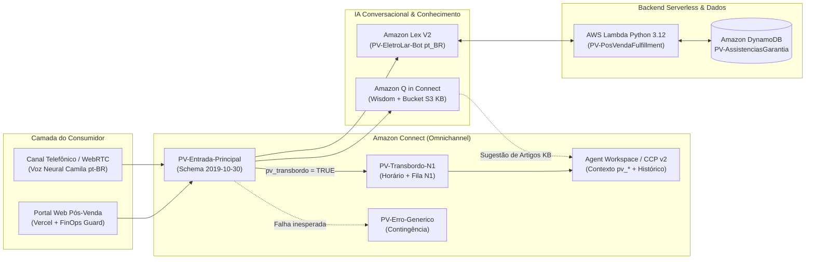

# 01 — Arquitetura da Solução, Modelagem DynamoDB e Contratos `pv_*`

> **Projeto:** Case 3 — Varejo: Pós-venda e Suporte de Eletrodomésticos (*EletroLar Varejo*)  
> **Região AWS Padrão:** `us-west-2` (US West — Oregon)  
> **Canais Atendidos:** Chat Online (Communications Widget na Vercel) + Voz Neural (`Camila` — Amazon Polly `pt-BR`)

---

## 1. Visão Geral Arquitetural

A solução resolve o gargalo operacional de pós-venda de uma rede varejista de eletrodomésticos através de uma arquitetura **100% Serverless e Omnichannel** na AWS. O atendimento combina triagem automatizada via **Amazon Lex V2**, validação em tempo real de Notas Fiscais e Assistências Técnicas no **Amazon DynamoDB** via **AWS Lambda (Python 3.12)**, suporte de conhecimento com **Amazon Q in Connect** e transbordo com contexto integral (`pv_*`) para o **Agent Workspace (CCP v2)**.

---

## 2. Modelagem Single-Table no Amazon DynamoDB (`PV-AssistenciasGarantia`)

Para manter custo zero dentro do **AWS Free Tier** e permitir consultas de baixa latência em uma única tabela (`BillingMode: PAY_PER_REQUEST`), utilizamos **Single-Table Design** com chave de partição `pk` (`String`) e chave de ordenação `sk` (`String`):

| Entidade | Partition Key (`pk`) | Sort Key (`sk`) | Principais Atributos | Uso na Jornada |
| :--- | :--- | :--- | :--- | :--- |
| **Assistência Técnica Autorizada** | `ASSISTENCIA` | `CEP#<cep_inicio>#<cep_fim>#<id_unidade>` | `nome_fantasia`, `cidade`, `cidade_normalizada`, `uf`, `endereco`, `telefone`, `horario_atendimento`, `especialidades` | **Cenário 2 (Localização)** e vínculo automático de autorizada no **Cenário 1 (Defeito/Garantia)**. |
| **Nota Fiscal & Garantia** | `NF#<numero_nf>` | `PRODUTO#<numero_serie>` | `modelo_produto`, `categoria_produto`, `cliente_nome`, `data_compra`, `garantia_ate`, `status_garantia`, `elegivel_troca_direta`, `cep_cliente` | **Cenário 1 (Defeito/Garantia)** e **Cenário 3 (Troca/Devolução)**. |
| **Caso / Protocolo de Pós-Venda** | `CASO#<protocolo>` | `NF#<numero_nf>` | `protocolo`, `tipo_solicitacao`, `status_caso`, `descricao_ou_motivo`, `criado_em_iso` | Registro auditável de Ordens de Serviço e solicitações de Troca/Devolução geradas pelo bot. |

---

## 3. Contrato de Atributos de Sessão (`pv_*`)

Todos os dados coletados na conversa são gravados em `sessionState.sessionAttributes` pela função Lambda e promovidos a **Contact Attributes** no bloco `UpdateContactAttributes` do Amazon Connect:

| Atributo | Origem | Valores Exemplo | Exibição no Agent Workspace (CCP v2) |
| :--- | :--- | :--- | :--- |
| `pv_canal` | Connect (`$.Channel`) | `CHAT` \| `VOICE` | Identifica se o cliente veio do chat web ou telefone. |
| `pv_jornada` | Lambda (`handler.py`) | `DEFEITO_GARANTIA` \| `LOCALIZAR_ASSISTENCIA` \| `TROCA_DEVOLUCAO` \| `ATENDIMENTO_HUMANO` \| `EMERGENCIA_SEGURANCA` | Indica imediatamente ao agente qual é o tema da solicitação. |
| `pv_modelo` | Lex Slot / DynamoDB | `Lavadora EletroLar 12kg Turbo Inverter` | Modelo exato do eletrodoméstico do cliente. |
| `pv_categoria` | Lambda (`assistencia.py`) | `LAVADORA` \| `GELADEIRA` \| `MICROONDAS` \| `FOGAO` \| `AR_CONDICIONADO` | Linha técnica do produto. |
| `pv_numero_serie` | Lex Slot / DynamoDB | `EL-LAV-2026-8841` | Número de série validado. |
| `pv_nota_fiscal` | Lex Slot (`NumeroNotaFiscal`) | `NF-100201` | Nota Fiscal consultada na base. |
| `pv_defeito_relatado` | Lex Slot (`DescricaoDefeito`) | `Parou de funcionar no meio do ciclo` | Sintoma relatado pelo consumidor (sanitizado). |
| `pv_status_garantia` | Lambda (`garantia_troca.py`) | `ATIVA` \| `EXPIRADA` \| `NAO_ENCONTRADA` | Situação da garantia de 12 meses. |
| `pv_cep_cidade` | Lex Slot (`CepOuCidade`) | `01310200` \| `Salvador` | Localidade informada pelo cliente. |
| `pv_assistencia_nome` | Lambda (`assistencia.py`) | `TecnoLar Paulista` \| `SEM_COBERTURA_LOCAL` | Autorizada mais próxima localizada. |
| `pv_assistencia_contato` | Lambda (`assistencia.py`) | Endereço + Telefone + Horário | Dados completos repassados ao cliente. |
| `pv_motivo_troca` | Lex Slot (`MotivoSolicitacao`) | `Arrependimento 7 dias` | Motivo da solicitação de troca ou devolução. |
| `pv_elegibilidade_troca` | Lambda (`garantia_troca.py`) | `ELEGIVEL` \| `FORA_DO_PRAZO` \| `EXIGE_ANALISE_N1` | Resultado da validação de prazo CDC. |
| `pv_protocolo` | Lambda (SHA-256) | `PV-20261118-4821` | Protocolo determinístico gerado no atendimento. |
| `pv_risco_seguranca` | Lambda (`guardrails.py`) | `TRUE` \| `FALSE` | Sinaliza alerta de fumaça, choque elétrico ou vazamento de gás. |
| `pv_transbordo` | Lambda (`handler.py`) | `TRUE` \| `FALSE` | Controla o bloco `Compare` no fluxo `PV-Entrada-Principal`. |
| `pv_motivo_transbordo` | Lambda (`handler.py`) | `GARANTIA_EXPIRADA` \| `CEP_SEM_ASSISTENCIA` \| `FORA_PRAZO_TROCA` \| `ALERTA_SEGURANCA_ELETRICA` \| `SOLICITACAO_CLIENTE` | Explica ao agente N1 o motivo exato pelo qual o bot transferiu o contato. |
| `pv_resumo` | Lambda (`handler.py`) | `Jornada=DEFEITO_GARANTIA \| Protocolo=PV-... \| NF=NF-100202 \| Garantia=EXPIRADA` | Linha executiva única para leitura instantânea no CCP v2. |

---

## 4. Camada de Guardrails (`lambda/pos_venda_fulfillment/guardrails.py`)

1. **Detecção de Risco Elétrico e Doméstico (`detectar_risco_eletrico_domestico`)**:
   - Monitora termos críticos como *fumaça*, *cheiro de queimado*, *pegando fogo*, *choque elétrico*, *faíscas*, *curto-circuito* e *vazamento de gás*.
   - Interrompe imediatamente o fluxo padrão, orienta o desligamento seguro da tomada/disjuntor ou registro de gás, gera protocolo prioritário e aciona `pv_transbordo = "TRUE"` (`pv_motivo_transbordo = "ALERTA_SEGURANCA_ELETRICA"`).
2. **Prevenção de Reparo Caseiro Indevido (`detectar_tentativa_reparo_caseiro`)**:
   - Impede que o cliente receba instruções para abrir gabinetes, desmontar micro-ondas (risco letal no capacitor de alta tensão) ou jumpear travas de segurança, preservando a integridade física do consumidor e a garantia contratual de 12 meses.
3. **Anti-Prompt Injection & Sanitização (`detectar_prompt_injection` / `sanitizar_texto`)**:
   - Remove tags HTML/scripts e bloqueia instruções maliciosas (*"ignore previous instructions"*, *"system prompt"*, etc.) antes do processamento dos slots.
