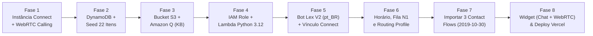

# 02 — Guia Passo a Passo de Implantação (Console AWS Bottom-Up + WebRTC + Vercel)

Este runbook detalha **clique a clique** como provisionar **100% da solução EletroLar Varejo (Case 3)** na região **`us-west-2` (US West — Oregon)**, incluindo a **criação da instância do Amazon Connect do zero**, a **habilitação de chamadas de voz via WebRTC (`In-app, web, and video calling`)**, o banco **DynamoDB**, a **Lambda Python 3.12**, o bot **Amazon Lex V2 (`pt_BR` com voz neural `Camila`)**, o **Amazon Q in Connect**, os **Contact Flows** e o **Communications Widget (Chat + Voz WebRTC)** na Vercel.

---

## Visão Geral da Ordem de Provisionamento (Zero Retrabalho)



> **Região obrigatória em todas as abas do Console AWS:** selecione **`US West (Oregon) us-west-2`** no canto superior direito antes de iniciar.

---

## Fase 1 — Criar a Instância do Amazon Connect e Habilitar Chamadas WebRTC

### 1.1 Criar a Instância do Amazon Connect do Zero
1. No Console AWS (`us-west-2`), pesquise por **Amazon Connect** e clique em **Add an instance** (ou **Create instance**).
2. **Step 1 — Set identity:**
   - Selecione **Store users in Amazon Connect**.
   - Em **Access URL**, digite um alias exclusivo para o laboratório (ex.: `eletrolar-posvenda-case3`).
   - Clique em **Next**.
3. **Step 2 — Add administrator:**
   - Selecione **Add a new admin** e preencha:
     - **First name / Last name:** seu nome
     - **Username:** `admin.eletrolar` (ou de sua preferência)
     - **Password:** crie uma senha forte
     - **Email address:** seu e-mail
   - Clique em **Next**.
4. **Step 3 — Set telephony (Essencial para Voz e WebRTC):**
   - Marque **Allow incoming calls** (Permitir chamadas recebidas).
   - Marque **Allow outbound calls** (Permitir chamadas de saída).
   - Clique em **Next**.
5. **Step 4 — Data storage:**
   - Mantenha as configurações padrão (o Amazon Connect criará automaticamente o bucket S3 e a criptografia KMS para logs de fluxo, gravações e transcrições do chat/voz).
   - Clique em **Next**.
6. **Step 5 — Review and create:**
   - Revise os dados e clique em **Create instance**.
   - Aguarde cerca de **2 a 3 minutos** até o status mudar para **Active**.

### 1.2 Habilitar Chamadas de Voz WebRTC (`In-app, web, and video calling`) e Logs
Ainda no Console AWS (`Amazon Connect` $\rightarrow$ clique no nome do **Instance Alias** recém-criado):

1. **Habilitar WebRTC (Chamadas de Voz pelo Navegador sem precisar de número 0800):**
   - No menu lateral esquerdo da instância no Console AWS, clique em **Telephony**.
   - Marque a caixa **Enable in-app, web, and video calling** (permite que o cliente ligue por voz diretamente pelo Communications Widget na sua Landing Page usando o microfone do navegador via protocolo WebRTC do Amazon Chime SDK).
   - Clique em **Save**.
2. **Habilitar Logs no CloudWatch (`Flow logs`):**
   - No menu lateral esquerdo da instância no Console AWS, clique em **Data storage** (ou **Flows**).
   - Certifique-se de que **Enable Flow logs** está marcado para gravar os logs no grupo `/aws/connect/<INSTANCE_ALIAS>`.
3. **Habilitar Contact Lens (Opcional Recomendado):**
   - No menu lateral **Analytics tools**, marque **Enable Contact Lens** e clique em **Save**.

---

## Fase 2 — Amazon DynamoDB (`PV-AssistenciasGarantia`) e Carga de Dados

1. No Console AWS (`us-west-2`), abra **Amazon DynamoDB** $\rightarrow$ **Tables** $\rightarrow$ **Create table**:
   - **Table name:** `PV-AssistenciasGarantia`
   - **Partition key:** `pk` (Tipo: `String`)
   - **Sort key:** `sk` (Tipo: `String`)
   - **Table settings:** selecione **Customize settings** $\rightarrow$ em **Read/write capacity settings**, escolha **On-demand** (`PAY_PER_REQUEST`, coberto pelo Free Tier).
   - Clique em **Create table** e aguarde o status `Active`.
2. No terminal da sua máquina (com `aws configure` apontando para sua conta em `us-west-2`), execute o script de carga para inserir as **12 assistências técnicas autorizadas** e as **10 notas fiscais simuladas**:

```bash
python scripts/seed_dynamodb.py --table PV-AssistenciasGarantia --region us-west-2
```

---

## Fase 3 — Amazon S3 e Amazon Q in Connect (Base de Conhecimento)

### 3.1 Criar o Bucket S3 e Subir os Artigos da Base de Conhecimento
1. No Console AWS (`us-west-2`), acesse **Amazon S3** $\rightarrow$ **Create bucket**:
   - **Bucket name:** `pv-kb-eletrolar-<SEU_SUFIXO>-us-west-2`
   - **Block Public Access:** mantenha **Block all public access** marcado.
   - Clique em **Create bucket**.
2. Entre no bucket criado $\rightarrow$ clique em **Upload** $\rightarrow$ **Add files** e envie os 3 manuais da pasta [`knowledge-base/`](../knowledge-base/):
   - `01-troubleshooting-lavadoras.md`
   - `02-troubleshooting-refrigeracao-microondas.md`
   - `03-politica-garantia-troca-devolucao.md`
   - Clique em **Upload**.

### 3.2 Configurar o Domínio do Amazon Q in Connect (Wisdom)
1. Volte em **Amazon Connect** no Console AWS $\rightarrow$ clique na sua instância $\rightarrow$ menu lateral **Amazon Q in Connect**.
2. Clique em **Add domain**:
   - **Domain name:** `PV-Q-Assistant`
   - **Knowledge base name:** `PV-Q-KnowledgeBase`
   - **Integration type:** selecione **Amazon S3** e aponte para o bucket `pv-kb-eletrolar-<SEU_SUFIXO>-us-west-2`.
   - Clique em **Save**.
   *(Nota: O bloco `CreateWisdomSession` no nosso Contact Flow já possui a porta `Error` conectada em contingência, portanto o fluxo nunca falha mesmo se o domínio Q ainda estiver indexando).*

---

## Fase 4 — IAM Role e Função AWS Lambda (`PV-PosVendaFulfillment`)

### 4.1 Gerar o Pacote `.zip` Limpo
Na raiz do repositório, execute:

```bash
python scripts/empacotar_lambda.py
```
O pacote será gerado em `dist/pos_venda_fulfillment.zip` contendo os módulos Python e o dataset `data/pos_venda_varejo.json` embarcado como fallback resiliente.

### 4.2 Criar a Função Lambda e Permissões no DynamoDB
1. No Console AWS (`us-west-2`), abra **AWS Lambda** $\rightarrow$ **Create function**:
   - Selecione **Author from scratch**.
   - **Function name:** `PV-PosVendaFulfillment`
   - **Runtime:** `Python 3.12`
   - **Architecture:** `x86_64`
   - Em **Change default execution role**, selecione **Create a new role with basic Lambda permissions**.
   - Clique em **Create function**.
2. Na aba **Code**:
   - Clique em **Upload from** $\rightarrow$ **.zip file** $\rightarrow$ selecione `dist/pos_venda_fulfillment.zip` $\rightarrow$ **Save**.
   - Role até **Runtime settings** $\rightarrow$ clique em **Edit** e mude o **Handler** de `lambda_function.lambda_handler` para:
     ```text
     handler.lambda_handler
     ```
   - Clique em **Save**.
3. Na aba **Configuration** $\rightarrow$ **General configuration** $\rightarrow$ **Edit**:
   - **Memory:** `256 MB`
   - **Timeout:** `0 min 10 sec`
   - Clique em **Save**.
4. Na aba **Configuration** $\rightarrow$ **Environment variables** $\rightarrow$ **Edit**, adicione:
   - `DYNAMODB_TABLE` = `PV-AssistenciasGarantia`
   - `USE_DYNAMODB` = `true`
   - Clique em **Save**.
5. Na aba **Configuration** $\rightarrow$ **Permissions**, clique no nome da Role criada em *Execution role* para abrir o console do **IAM**:
   - Clique em **Add permissions** $\rightarrow$ **Create inline policy** $\rightarrow$ aba **JSON** e cole:
   ```json
   {
     "Version": "2012-10-17",
     "Statement": [
       {
         "Sid": "AcessoTabelaPosVendaDynamoDB",
         "Effect": "Allow",
         "Action": [
           "dynamodb:GetItem",
           "dynamodb:Query",
           "dynamodb:Scan",
           "dynamodb:PutItem"
         ],
         "Resource": "arn:aws:dynamodb:us-west-2:*:table/PV-AssistenciasGarantia"
       }
     ]
   }
   ```
   - Nomeie a política como `PV-DynamoDBPosVendaPolicy` e clique em **Create policy**.

---

## Fase 5 — Bot Conversacional Amazon Lex V2 (`PV-EletroLar-Bot`)

### 5.1 Criar o Bot em Português do Brasil (`pt_BR`) com Voz Neural Camila
1. No Console AWS (`us-west-2`), abra **Amazon Lex V2** $\rightarrow$ **Create bot**:
   - **Creation method:** *Create a blank bot*
   - **Bot name:** `PV-EletroLar-Bot`
   - **IAM permissions:** *Create a role with basic Amazon Lex permissions*
   - **COPPA:** `No`
   - **Idle session timeout:** `5 minutes`
   - Clique em **Next**.
2. Em **Add language to bot**:
   - **Language:** `Portuguese (Brazil)` (`pt_BR`)
   - **Voice interaction:** **`Camila`** (**Engine:** `Neural`)
   - **Intent classification confidence score threshold:** `0.40`
   - Clique em **Done**.

### 5.2 Criar os 4 Slot Types Customizados (`lex/slot-types.json` / `scripts/provisionar_lex_v2.py`)
> **Dica IaC:** Você pode provisionar todo o bot, roles, intents, slots e aliases automaticamente via `python3 scripts/provisionar_lex_v2.py --region us-west-2`, ou configurar manualmente abaixo:

No menu lateral **Slot types** $\rightarrow$ **Add slot type** $\rightarrow$ **Add blank slot type**:
1. **`PV_CategoriaEletrodomestico`** (*Restrict to slot values and synonyms*):
   - `LAVADORA`, `GELADEIRA`, `MICROONDAS`, `FOGAO`, `AR_CONDICIONADO` (com sinônimos populares).
2. **`PV_MotivoTrocaDevolucao`** (*Restrict to slot values and synonyms*):
   - `Arrependimento 7 dias`, `Produto avariado na entrega`, `Defeito funcional nos primeiros dias`, `Voltagem ou modelo divergente`.
3. **`PV_ModeloEletrodomestico`** (*Expand values* / `OriginalValue` — permite uso em utterances no Lex V2):
   - Exemplos base: `Lavadora 12kg`, `Lava e Seca 11kg`, `Geladeira FrostFree`, `Micro-ondas 32L`, `Fogão 5 Bocas`, `Ar-Condicionado Split`.
4. **`PV_LocalidadeCepCidade`** (*Expand values* / `OriginalValue` — captura qualquer CEP ou município livre):
   - Exemplos base: `01310-200`, `41820-020`, `69900-000`, `São Paulo`, `Salvador`, `Rio de Janeiro`, `Belo Horizonte`.

### 5.3 Configurar as Intenções (`lex/bot-export.json`)
Em todas as intenções abaixo, ative **Use a Lambda function for initialization and validation** (em *Dialog code hook*) e **Use a Lambda function for fulfillment** (em *Fulfillment*):
1. **`AcionarGarantiaDefeito`** (Cenário 1 — Defeito no produto):
   - Utterances de [`lex/bot-export.json`](../lex/bot-export.json) (ex.: `"minha máquina de lavar parou de funcionar"`, `"quero acionar a garantia do meu eletrodoméstico"`).
   - Slots obrigatórios: `ModeloProduto` (`AMAZON.FreeFormInput`), `NumeroSerie` (`AMAZON.AlphaNumeric`), `NumeroNotaFiscal` (`AMAZON.AlphaNumeric`), `DescricaoDefeito` (`AMAZON.FreeFormInput`).
2. **`LocalizarAssistenciaTecnica`** (Cenário 2 — Busca por CEP ou Cidade):
   - Utterances (ex.: `"quero localizar uma assistência técnica autorizada"`, `"buscar assistência autorizada no cep {CepOuCidade}"`, `"assistência técnica em {CepOuCidade}"`).
   - Slots: `CepOuCidade` (`AMAZON.FreeFormInput`, Obrigatório) e `CategoriaProduto` (`PV_CategoriaEletrodomestico`, Opcional).
3. **`SolicitarTrocaDevolucao`** (Cenário 3 — Troca / Devolução):
   - Utterances (ex.: `"quero trocar meu produto"`, `"quero devolver o produto da nota {NumeroNotaFiscal}"`).
   - Slots obrigatórios: `NumeroNotaFiscal` (`AMAZON.AlphaNumeric`), `ModeloProduto` (`AMAZON.FreeFormInput`), `MotivoSolicitacao` (`PV_MotivoTrocaDevolucao`).
4. **`FalarComAtendente`** (Cenário 4 — Transbordo Humano):
   - Utterances: `"quero falar com um atendente"`, `"falar com humano"`, `"transferir para especialista"`.
5. **`FallbackIntent`**:
   - Ative **Use a Lambda function for fulfillment**.

### 5.4 Build, Alias `Prod`, Vínculo com a Lambda e Autorização no Connect
1. Clique em **Build** e aguarde concluir.
2. Em **Bot versions** $\rightarrow$ **Create version** (`Version 1`).
3. Em **Aliases** $\rightarrow$ crie ou edite o alias **`Prod`** (associado à `Version 1`) $\rightarrow$ clique em **Portuguese (Brazil)** e selecione a função Lambda **`PV-PosVendaFulfillment`** (`$LATEST`) $\rightarrow$ **Save**.
4. **Autorizar o Bot no Amazon Connect:**
   - No Console AWS $\rightarrow$ **Amazon Connect** $\rightarrow$ clique na sua instância $\rightarrow$ menu lateral **Flows**.
   - Em **Amazon Lex**, selecione o bot **`PV-EletroLar-Bot`** e o alias **`Prod`** (`us-west-2`) e clique em **+ Add Amazon Lex Bot**.

---

## Fase 6 — Configurar Horário, Fila N1 e Perfil de Roteamento no Connect

Abra o painel administrativo da sua instância (`https://<INSTANCE_ALIAS>.my.connect.aws`) e faça login:

1. **Horário de Operação (`Routing` $\rightarrow$ `Hours of operation` $\rightarrow$ `Add new hours`):**
   - **Name:** `PV-Horario-Atendimento-N1`
   - **Time zone:** `America/Sao_Paulo`
   - Configure Segunda a Sábado das `08:00` às `20:00` *(Dica: durante os testes noturnos ou em finais de semana, deixe Segunda a Domingo `00:00` a `24:00` para garantir que o transbordo caia sempre no seu CCP v2 ao vivo)*.
   - Clique em **Save**.
2. **Fila de Atendimento N1 (`Routing` $\rightarrow$ `Queues` $\rightarrow$ `Add new queue`):**
   - **Name:** `PV-Fila-Suporte-PosVenda-N1`
   - **Hours of operation:** `PV-Horario-Atendimento-N1`
   - Clique em **Save**.
3. **Perfil de Roteamento (`Users` $\rightarrow$ `Routing profiles` $\rightarrow$ `Add new profile`):**
   - **Name:** `PV-Perfil-Agente-PosVenda-N1`
   - **Channels and concurrency:** marque **Voice** (Maximum `1` — necessário para receber chamadas de voz WebRTC!) e **Chat** (Maximum `3`).
   - Em **Queues**, adicione a fila **`PV-Fila-Suporte-PosVenda-N1`** para ambos os canais (`Voice` e `Chat`), Priority `1`, Delay `0`.
   - **Default outbound queue:** `PV-Fila-Suporte-PosVenda-N1`.
   - Clique em **Save**.
4. **Vincular ao seu Usuário (`Users` $\rightarrow$ `User management`):**
   - Clique no seu usuário admin/agente, mude o **Routing Profile** para **`PV-Perfil-Agente-PosVenda-N1`** e clique em **Save**.

---

## Fase 7 — Importar e Publicar os 3 Contact Flows (`connect-flows/`)

No painel do Amazon Connect, acesse **Routing** $\rightarrow$ **Flows**:

1. **`PV-Erro-Generico` (1º a importar):**
   - Clique em **Create flow** $\rightarrow$ seta ao lado de *Save* $\rightarrow$ **Import flow (beta)** $\rightarrow$ selecione [`connect-flows/PV-Erro-Generico.json`](../connect-flows/PV-Erro-Generico.json).
   - Clique em **Save** e em **Publish**.
2. **`PV-Transbordo-N1` (2º a importar):**
   - Clique em **Create flow** $\rightarrow$ **Import flow (beta)** $\rightarrow$ selecione [`connect-flows/PV-Transbordo-N1.json`](../connect-flows/PV-Transbordo-N1.json).
   - Clique no bloco **Set working queue** e selecione a sua fila **`PV-Fila-Suporte-PosVenda-N1`**.
   - Clique no bloco **Check hours of operation** e selecione **`PV-Horario-Atendimento-N1`**.
   - Clique em **Save** e em **Publish**.
3. **`PV-Entrada-Principal` (3º a importar):**
   - Clique em **Create flow** $\rightarrow$ **Import flow (beta)** $\rightarrow$ selecione [`connect-flows/PV-Entrada-Principal.json`](../connect-flows/PV-Entrada-Principal.json).
   - Clique no bloco **Amazon Q in Connect** e selecione o domínio **`PV-Q-Assistant`**.
   - Clique no bloco **Get customer input** e selecione o bot **`PV-EletroLar-Bot`** (Alias **`Prod`**).
   - Clique no bloco **Transfer to flow** e selecione **`PV-Transbordo-N1`**.
   - Clique em **Save** e em **Publish**.

---

## Fase 8 — Configurar o Communications Widget (Chat + Voz WebRTC) e Testar

### 8.1 Criar o Communications Widget com Chat e Web Calling (WebRTC)
1. No painel do Amazon Connect, acesse **Channels** $\rightarrow$ **Communication widgets** $\rightarrow$ **Add widget**:
   - **Name:** `PV-Widget-EletroLar`
   - **Description:** `Widget Omnichannel Pós-Venda EletroLar (Chat Online + Voz WebRTC)`
   - **Contact flow:** selecione **`PV-Entrada-Principal`**
   - **Opções de Canal (IMPORTANTE PARA WEBRTC):**
     - Marque **Add chat to website** (Habilita o Chat Online);
     - Marque **Add web calling to website** e, no campo **Web calling contact flow**, selecione também **`PV-Entrada-Principal`** (isso habilita o botão de ligação de voz via WebRTC dentro do widget!).
   - Clique em **Save and continue**.
2. Na tela de customização visual:
   - **Widget header:** `Pós-Venda EletroLar Varejo`
   - **Main color:** `#1d4ed8` (Azul EletroLar)
   - Clique em **Save and continue**.
3. Na tela **Allowed domains (Domínios permitidos)**:
   - Adicione a URL pública da sua Vercel (ex.: `https://amazon-connect-pos-vendas-case3.vercel.app`) **e/ou** `http://localhost:8080` para testes locais.
   - Desmarque *Require authentication (JWT)* para o laboratório.
   - Clique em **Save and continue**.
4. Copie o **Widget script** gerado (note que ele já virá com `iconType: 'CHAT_VOICE'`).

### 8.2 Injetar o Snippet e Testar Chamada WebRTC + Chat Online
1. **Teste Local (`localhost`):**
   - Cole o script copiado dentro de `landing/widget-snippet.local.html` (ignorado pelo `.gitignore`).
   - Execute no terminal:
     ```bash
     python scripts/injetar_widget.py
     python scripts/servir_local.py --porta 8080
     ```
2. **Deploy na Vercel:**
   - Em **Project Settings** $\rightarrow$ **Environment Variables** na Vercel, crie `CONNECT_WIDGET_SNIPPET` (ou `CONNECT_WIDGET_SNIPPET3`) com o script copiado e faça **Redeploy** (`node scripts/injetar_widget.js` via [`package.json`](../package.json)). O arquivo [`vercel.json`](../vercel.json) já libera todas as permissões de CSP e microfone (`Permissions-Policy: microphone=(self "https://*.my.connect.aws" "https://*.chime.aws")`) e WebSockets (`wss://*.chime.aws`) exigidos pelo **Amazon Chime SDK WebRTC**.
3. **Como testar a chamada de Voz WebRTC e o Chat ao vivo:**
   - Abra o **Agent Workspace / CCP v2** (`https://<INSTANCE_ALIAS>.my.connect.aws/agent-app-v2`) em uma aba, permita o uso do microfone no navegador e coloque o agente em **`Available`**.
   - Abra a Landing Page e clique no botão flutuante do **Amazon Connect** no canto inferior direito: você verá as duas opções (**Iniciar Chat** ou **Ligar por Voz WebRTC**).
   - Ao clicar para ligar por voz, a **Camila Neural (`pt-BR`)** saudará você pelo áudio do navegador; fale ao microfone (ex.: *"Minha máquina de lavar parou de funcionar"* ou *"Quero falar com um atendente"*) e acompanhe o transbordo tocando em tempo real no seu **CCP v2**!
